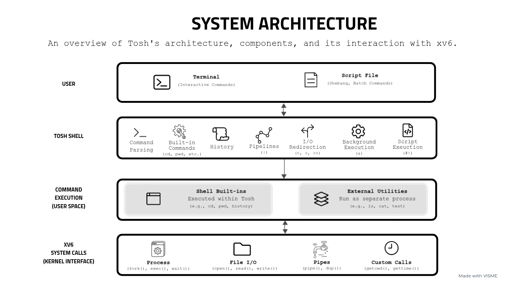

<div align="center">
  <h3 style="font-size: 2.1em; font-weight: bolder;">FogOS</h3>

  <p>
    An educational operating system built on xv6, featuring <strong>Tosh</strong>, a custom Unix-like command-line shell implemented in C.
    <br />
    <a href="https://github.com/ninoestrada/FogOS/tree/main/docs"><strong>Explore the docs »</strong></a>
    <br />
    <br />
    <a href="https://github.com/ninoestrada/FogOS/issues/new">Report Bug</a>
    ·
    <a href="https://github.com/ninoestrada/FogOS/issues/new">Request Feature</a>
  </p>
</div>

<!-- ABOUT THE PROJECT -->

## 📖 About the Project


**FogOS** is an educational operating-system project built on xv6, MIT's Unix-like teaching operating system. The project explores operating-system concepts and systems programming in C through the development of a custom command-line shell, Unix utilities, and kernel extensions.

## 🐚 **Tosh — The Operating Shell**

At the heart of FogOS is **Tosh (The Operating Shell)**, a custom Unix-like shell designed to make the command-line experience more approachable, engaging, and fun. Tosh combines familiar shell functionality with a colorful interface, interactive features, and a touch of personality to make navigating and interacting with the operating system feel less intimidating.

Beyond its interface, Tosh supports command execution, pipelines, I/O redirection, command history, and shell scripting. The project also includes a custom `test` utility for evaluating conditional expressions and extensions to xv6 supporting working-directory retrieval, command timing, file operations, and script execution.

### ✨ Features

- **Command Execution:** Execute external programs and shell-specific built-in commands.
- **Pipelines & I/O Redirection:** Connect processes using pipes and redirect input and output through file descriptors.
- **Background Execution:** Launch commands without waiting for their completion.
- **Command History:** Store up to 100 commands and support history replay using command numbers, prefixes, and shortcuts.
- **Shell Scripting:** Execute command files and support shebang-based script execution.
- **Dynamic Prompts:** Display the current working directory, command number, and previous command status.
- **Custom System Calls:** Extend xv6 with system calls for retrieving the current working directory and system time.
- **Filesystem Extensions:** Support append-mode file operations for shell output redirection.
- **Conditional Evaluation:** Evaluate file properties, string comparisons, and integer expressions using the custom test utility.

### **🛠️ Tech Stack**

[![C][C.com]][C-url]
<br />
[![Unix-like][Unix-like.com]][Unix-like-url]
<br />
[![Xv6][Xv6.com]][Xv6-url]
<br />
[![QEMU][QEMU.com]][QEMU-url]
<br />

## 🏗️ Architecture

### System Architecture

The diagram below illustrates Tosh's architecture, including command processing, shell execution, external utilities, and interactions with the xv6 operating system.



<!-- GETTING STARTED -->

## 📦 Getting Started

### 💾 Installation

**Prerequisites:** To build and run FogOS locally, you'll need:

- **QEMU** — Emulates the RISC-V environment used to run xv6. [Download QEMU](https://www.qemu.org/download/)
- **RISC-V GNU Toolchain** — Provides the compiler and related tools needed to build xv6.

1. Clone the repository.

    ```sh
    git clone https://github.com/ninoestrada/FogOS.git
    cd FogOS
    ```

2. Build FogOS.

    ```sh
    make
    ```

### ▶️ Running the Program

1. Launch FogOS in QEMU.

    ```sh
    make qemu
    ```

2. Start Tosh.

    Once xv6 has booted and the shell prompt appears, enter:

    ```sh
    tosh
    ```

    Tosh will launch within the emulated xv6 environment.

## 🧪 Testing

FogOS includes shell test scripts to validate Tosh's functionality, including built-in commands and command execution. See the Project Documentation section below for testing instructions.

## 📁 Project Documentation

- **Tosh — The Operating Shell:** [Documentation](docs/TOSH.md) · [Source Code](user/tosh.c)
- **test — Conditional Evaluation Utility:** [Documentation](docs/TEST.md) · [Source Code](user/test.c)

## 🧑🏻‍💻 My Contributions

- Developed **Tosh**, a custom Unix-like shell in C, supporting command execution, built-in commands, pipelines, I/O redirection, and background execution to provide an interactive command-line environment.
- Implemented a 100-entry circular buffer for command history and replay, along with shell scripting and dynamic prompts to make command-line interactions more convenient and approachable.
- Extended the xv6 kernel with custom `getcwd` and `gettime` system calls, enabling working-directory retrieval and access to system time.
- Modified xv6's filesystem and executable loader to support append-mode file operations and shebang-based script execution.
- Built a custom `test` utility in C to evaluate file properties, string comparisons, and integer expressions for conditional checks.
- Created shell test scripts to verify command execution, history functionality, and conditional expressions.

<!-- LICENSE -->

## 📜 License

Distributed under the xv6 License. See [`xv6-LICENSE`](xv6-LICENSE) for more information.

<!------- MARKDOWN LINKS & IMAGES ------->

[C.com]: https://img.shields.io/badge/C-00599C?style=for-the-badge&logo=c&logoColor=white
[C-url]: https://www.iso.org/standard/74528.html
[Unix-like.com]: https://img.shields.io/badge/Unix-like-4285F4?style=for-the-badge&logo=unix-like
[Unix-like-url]: https://en.wikipedia.org/wiki/Unix-like
[Xv6.com]: https://img.shields.io/badge/Xv6-100000?style=for-the-badge&logo=xv6
[Xv6-url]: https://github.com/mit-pdos/xv6-riscv
[QEMU.com]: https://img.shields.io/badge/QEMU-EE0000?style=for-the-badge&logo=qemu
[QEMU-url]: https://www.qemu.org/
